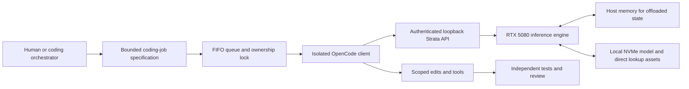

# Architecture Notes

Extracted from the OCF V1 case study by Arun C Michael.

## 3. System Architecture and Memory Hierarchy

### 3.1 Workstation Configuration Envelope
All measurements were recorded on an isolated portable environment running on a single Windows workstation.

| Component or Parameter | Verified Value | Operational Role / Scope |
| :--- | :--- | :--- |
| **Operating Environment** | Windows (isolated portable lab directory) | Isolated from system-wide Python and existing model stores |
| **GPU Hardware** | NVIDIA RTX 5080 (marketed 16 GB; 16,303 MiB reported total) | Primary compute and hot-weight/KV tier |
| **Host System Memory** | High-RAM host system (see Hardware Box below) | Holds offloaded model state and execution buffers |
| **Strata Terminal / Control** | `0.2.9` / `0.1.55` | Hybrid GPU/CPU/NVMe inference runtime |
| **Engine GPU Target** | `CUDA 13`, `sm120` (Blackwell architecture) | Native architecture target |
| **Portable Python Runtime** | `3.12.15` | Dedicated environment for client and tooling |
| **OpenCode Client** | `1.19.5` | Isolated state, SQLite database, and configuration |
| **Active Storage Tier** | Local NVMe SSD (`<NVME_DIR>`) | Hosts GGUF shards and direct-lookup `PLE` tables |
| **Archive Storage Tier** | External USB HDD | Reserved strictly for cold archives; never active lookups |
| **Context Capacity** | `131,072` tokens (`1` inference slot) | Single-slot serialized execution |
| **KV Cache Configuration** | `INT8` precision; `32,768` resident window | Balances context fidelity against VRAM limits |
| **Coding Profile (`deep`)** | High/Deep reasoning; `16,384` max output tokens | Default profile for all code-modification jobs |
| **Compaction Profile** | Same model weights via alias; `no-thinking`; `4,096` output cap | Prevents reasoning token bloat during summaries |
| **Vision Subsystem** | Disabled | Omitted to conserve memory and context headroom |
| **Multi-Token Prediction (MTP)** | Enabled; configured speculative count `4` | Accelerates token generation; supplementary drafts logged |
| **PLE Placement Policy** | Explicit `direct` SSD access | Prevents automatic 26.8 GiB host-RAM preload |
| **Configured VRAM Reserve** | `1,536 MiB` | Profile reserve; monitor under heavy desktop concurrency |
| **API Transport** | Authenticated OpenAI-compatible HTTP on `127.0.0.1` | Loopback only (`http://127.0.0.1:8081/v1`) |
| **Idle Resource Release** | `600` seconds without inference activity | Unloads model weights while keeping API process online |

> **Workstation Host Memory Envelope (Optional Public Disclosure Box)**  
> *Note: In the main narrative, host memory is referred to as a "high-RAM host" to preserve hardware privacy. If approved for full hardware disclosure upon publication, include this box:*  
> - **Host RAM Configuration:** `96 GiB DDR4` system memory.  
> - **Preflight Memory Guards:** The 128K startup guard checks for `~75 GiB` available physical RAM and `~85 GiB` OS commit headroom before loading weights.  
> - **Loaded Point Telemetry:** During an active 128K inference snapshot, host RAM occupancy measured `72.2 GiB` alongside `15,074 MiB` GPU VRAM occupancy.  
> *Reproducibility Boundary:* Host-memory channel geometry, clock speed, and PCIe interconnect bandwidth govern offloaded state transfer rates. These results represent a high-RAM workstation and will not run unmodified on a standard 16 GB or 32 GB desktop PC.

### 3.2 End-to-End Orchestration Topology (`OCF V1`)
The **OCF V1 (OpenCode FlashNext)** protocol separates high-level architectural orchestration from token-heavy implementation. The orchestrator writes a bounded coding specification, hands it off to the local FIFO queue, and waits to verify the resulting diff and unit tests.

### 3.3 Attribution Boundary: Upstream Features vs. OCF Integration
* **Upstream Strata Features:** Hybrid GPU/host/SSD execution, `MTP` speculative decoding, `INT8` KV caching with a configurable resident window, `PLE` storage placement modes, the loopback OpenAI-compatible HTTP server, and the 600-second automatic idle model unload timer.
* **Upstream OpenCode Features:** Terminal-based agentic file reading/editing, scoped tool execution, session state tracking, prior-summary filtering, and conversation compaction triggers.
* **Custom Engineering Integration (`OCF V1` by Arun C Michael):** The multi-engine orchestration protocol (`OCF_<ID>_PROMPT.md` and `OCF_<ID>_RESULT.md` contracts), PowerShell execution and queue runners (`ocf-exec`, `ocf-enqueue`, `ocf-worker`, `ocf-status`), named-mutex + PID/start-time atomic lock management, conservative resource preflight guards, and the wire-level request hook that strips inherited reasoning parameters from compaction calls.

### 3.4 Disambiguating Memory and Storage Objects
Running an 83.62 GB sparse model across a 16 GB GPU, host DRAM, and NVMe storage involves six distinct memory and storage structures that must not be conflated as a single cache:
1. **Sharded Model Weights (`83.62 GB` on NVMe):** The static `IQ3_S` quantized tensor shards stored in `<MODEL_DIR>`.
2. **Active VRAM Allocation (up to `15,074 MiB` observed on RTX 5080):** Hot layers, active execution buffers, router weights, and the resident `32,768`-token `INT8` KV cache window held in GPU memory.
3. **Host DRAM Offloaded State:** Offloaded model layers, extended KV state beyond the resident GPU window, and runtime buffers held in system RAM.
4. **Per-Layer Embedding / Lookup Assets (`PLE`):** Large lookup tables (`~28.8 GB` decimal / `~26.8 GiB` binary) accessed via `direct` NVMe reads from `<NVME_DIR>` rather than residing permanently in host RAM.
5. **Engine Prompt Prefix Cache:** In-memory state retained by Strata across sequential turn requests within the active slot, enabling unchanged conversation prefixes to bypass redundant prefill computation (`98.09%` token-accounting reuse recorded in active sampling).
6. **Client Session Database (`OpenCode` SQLite state):** Persistent disk records of conversation turns, tool outputs, and validated summary checkpoints stored in `<LAB_ROOT>`.

---

### 4.4 Shared Slot Ownership and FIFO Queue Hardening (`OCF V1`)
To coordinate multiple coding slices across a single GPU slot (`slots = 1`), `OCF V1` uses a serialized queue backed by `<LAB_ROOT>/state/ocf.lock` and per-job artifacts in `.handoff/` (`OCF_<ID>_PROMPT.md`, `OCF_<ID>_RESULT.md`, `OCF_<ID>_STDERR.log`, `OCF_<ID>_RAW.jsonl`, and `OCF_HOST_HEALTH.md`).

#### 4.4.1 Early Runner Defect Fixes
Initial sandbox validation (`S1`: `mergeRanges` in `deep` mode, passing `7/7` `node --test` assertions; `S2`: `clamp` in `balanced` mode, passing `2/2` assertions) surfaced four Windows runner issues that were fixed before production deployment:
1. **PowerShell Parser Encoding:** Replaced Unicode em-dashes in `.ps1` scripts with strict ASCII strings.
2. **Space-Containing Path Truncation:** Replaced `Start-Process -ArgumentList` (which failed with exit code `-196608` on paths containing spaces) with `.NET` `ProcessStartInfo`, custom Windows argument quoting (`Format-OcfWinArg`), and `-f` file prompt attachment.
3. **Dirty Git Tree Delta Calculation:** Captured `git status --porcelain` before and after job execution so pre-existing untracked files or templates were not miscounted as engine modifications.
4. **Explicit Exit Code Casting:** Eliminated empty `ExitCode` ambiguity via explicit integer casting and enforced exit code `124` on timeouts.

#### 4.4.2 Atomic Lock Hardening
After reproducing four concrete lock race conditions under concurrent worker launches, the queue ownership mechanism was hardened around six strict invariants:
* **Named Mutex + Atomic File Creation:** Lock operations synchronize via a system-wide Windows named mutex and create the ownership record atomically using `FileMode.CreateNew`.
* **PID + Process Creation Timestamp Verification:** To defeat OS PID-reuse collisions, ownership validation checks both the integer `PID` and the exact OS process start timestamp.
* **Unconditional Preservation of Live Owners:** A long-running or queued job is never treated as stale merely because it exceeds two hours. Live owner processes are never stolen or killed regardless of age; locks are reclaimed only when the recorded `PID`/start-time identity is demonstrably dead.
* **Read-Only Status Probes:** `ocf-status` is strictly read-only and never deletes or mutates `ocf.lock`.
* **Safe Handling of Unreadable Records:** Unreadable or mid-write ownership files are preserved rather than blindly unlinked.
* **Orphaned Queue State Reconciliation:** If a child worker exits while a job record still displays `Status: queued`, the supervisor writes a terminal `failed` status into `OCF_<ID>_RESULT.md` so callers never hang indefinitely.
