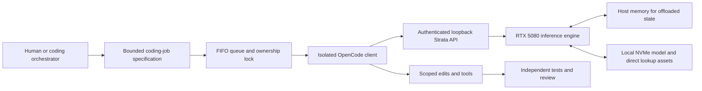

# Beyond VRAM Capacity: A Single-Workstation Case Study of Strata, Qwen3.8-Flash-Next, and OpenCode on an RTX 5080

**Author:** Arun C Michael  
**Date:** November 2026  
**Subject:** Single-slot local coding orchestration (`OCF V1`), hybrid memory placement, client compaction control, and serialized queue hardening on a 16 GB GPU envelope.

---

## Abstract

A persistent misconception in local language model deployment is that a GPU’s physical video memory (VRAM) ceiling defines the maximum total parameter weight of a usable coding model. On a 16 GB consumer GPU, this assumption restricts practitioners to small dense models that frequently struggle with multi-file reasoning or complex algorithmic synthesis. This paper documents a single-workstation systems engineering architecture conducted by Arun C Michael that runs an 83.62 GB (decimal on-disk weight) quantized sparse model—`ISTA-DASLab/Qwen3.8-Flash-Next-GSQ-RCO-GGUF` (`IQ3_S` quantization, referred to operationally as `FlashNext`)—on an NVIDIA RTX 5080 (16,303 MiB reported VRAM) paired with a high-RAM Windows host and local NVMe storage.

Rather than claiming a universal model benchmark or unconditional parity with frontier cloud APIs, this study details the systems engineering required to make an oversized sparse model operationally viable for autonomous software engineering tasks. We present the **OpenCode FlashNext (OCF V1)** orchestration protocol, which couples an external IDE orchestrator (such as Cursor, Claude Code, or Windsurf) with an isolated **OpenCode** client and a loopback **Strata** inference endpoint across a serialized, single-slot First-In-First-Out (FIFO) job queue. We report verified empirical measurements across five core engineering interventions: (1) explicit Per-Layer Embedding / lookup (`PLE`) placement on direct NVMe storage to eliminate an automatic 28.8 GB (26.8 GiB) host-RAM residency spike; (2) client context budgeting at 131,072 tokens with a hard 81,920-token compaction trigger; (3) wire-verified disabling of inherited reasoning tokens during context compaction, reducing summary generation time from 69.282 seconds to 18.360 seconds (a 69.7% token reduction on a paired fixture); (4) atomic Windows mutex and process-identity lock hardening across concurrent queue workers; and (5) deterministic 600-second idle GPU unloading. Finally, we document negative findings—including zero-reasoning formatting compliance trade-offs, single-slot FIFO queue waiting latency, and a transient 0 MiB free-VRAM log warning—and provide a complete reproduction protocol for engineering teams.

---

## 1. Introduction and Engineering Thesis

### 1.1 The Cloud Token vs. Local Slot Dilemma
Software engineering teams using agentic IDE environments (such as Cursor, Windsurf, or cloud CLI agents) incur substantial token consumption when frontier cloud models iteratively read files, synthesize patches, fail verification tests, and re-prompt within closed tool loops. Offloading bounded implementation slices to a local workstation GPU restricts the cloud orchestrator to task specification, diff verification, and test execution while moving high-volume code synthesis onto local hardware.

However, transitioning from cloud APIs to a single-workstation 16 GB GPU introduces two structural bottlenecks:
1. **Memory Hierarchy Constraints:** A model whose quantized weights exceed 83 GB on disk cannot reside wholly in 16 GB of VRAM. Achieving interactive throughput requires a sparse architecture where active parameters, attention caches, and hot weights fit within VRAM and host DRAM, while cold lookup structures are explicitly managed across NVMe storage and system memory.
2. **Single-Slot Contention:** A workstation GPU operating near its memory and compute limits supports a single active inference slot (`slots = 1`) at a 131,072-token context length. When multiple IDE sessions, background tasks, or agent lanes target the same local endpoint concurrently, uncoordinated requests exhaust memory, trigger premature timeouts, or cause operators to abandon the local queue and write changes directly with paid cloud tokens.

### 1.2 Engineering Thesis
A GPU’s weight-storage capacity is not the same as the maximum size of a usable local model. A quantized sparse model, host-memory offloading, explicit storage placement, and a hybrid inference engine can support reliable local coding on a 16 GB GPU. However, obtaining tokens from a large model is only a fraction of the engineering problem: sustained usability requires strict context budgeting, non-reasoning client compaction, atomic resource ownership across a serialized job queue, deterministic idle resource release, and disciplined measurement.

---

## 2. Verified Artifact Identity and Provenance

All experiments in this study were executed using verified upstream artifacts and cryptographically hashed local weight shards recorded on 3–4 November 2026 (IST).

### 2.1 Primary Upstream Sources and Hashes
* **Strata Inference Engine:** `https://github.com/Niko1221/Strata` (Terminal `0.2.9` / Control `0.1.55`, compiled for `CUDA 13`, `sm120`)
* **Quantized Model Repository:** `https://huggingface.co/ISTA-DASLab/Qwen3.8-Flash-Next-GSQ-RCO-GGUF`
* **Verified Model Repository Revision:** `ed59f92082b1e93c0e96d60a8b11aab089b52f09`
* **OpenCode Client Repository:** `https://github.com/anomalyco/opencode` (Version `1.19.5`)
* **Local Native / API Alias:** `qwen3.8-flash-next-iq3_s`
* **Client Model Identifier:** `strata/qwen3.8-flash-next-iq3_s`

| Artifact | Verified Size (Decimal Bytes) | Verified Size (Decimal GB) | Verified SHA-256 Digest |
| :--- | ---: | ---: | :--- |
| **GGUF Shard 1** | 54,817,524,224 | 54.82 GB | `4c1eb2ceb4915e1192f4f386021897bde56a97f40a0bb78bb86465e0f7d2aca3` |
| **GGUF Shard 2** | 28,800,138,432 | 28.80 GB | `316b46f3a2dbd68c900f43136ab9449f9dcc3725dfd8c794847c204bc161e113` |
| **Total GGUF Weights** | **83,617,662,656** | **83.62 GB** | *Two weight shards; runtime and MTP draft assets stored separately* |

*Unit Convention:* Disk file sizes use decimal units (bytes, GB = $10^9$ bytes), whereas memory allocations marked with binary units (MiB = $2^{20}$ bytes, GiB = $2^{30}$ bytes) reflect OS and GPU driver reporting. An 83.62 GB on-disk GGUF weight footprint does **not** represent an 83.62 GB VRAM allocation. Adopters should always fetch weights and runtime binaries directly from the official upstream repositories and verify the SHA-256 checksums above rather than redistributing informal weight copies.

### 2.2 Baseline vs. Candidate Configuration
To evaluate whether the operational complexity of running the 83.62 GB sparse configuration is justified, `FlashNext` was benchmarked against a local dense baseline on the same workstation:
* **Dense Baseline:** An approximately 11.8 GB on-disk, 26.9B-parameter dense `IQ3_S` model served via native **Ollama** (verified via model metadata).
* **Sparse Candidate (`FlashNext`):** The 83.62 GB two-shard `IQ3_S` sparse model served via **Strata** (`0.2.9` / `0.1.55`) with Multi-Token Prediction (`MTP`) speculative decoding enabled.

---

## 3. System Architecture and Memory Hierarchy

### 3.1 Workstation Configuration Envelope
All measurements were recorded on an isolated portable environment running on a single Windows workstation.

| Component or Parameter | Verified Value | Operational Role / Scope |
| :--- | :--- | :--- |
| **Operating Environment** | Windows (isolated portable lab directory) | Isolated from system-wide Python and existing model stores |
| **GPU Hardware** | NVIDIA RTX 5080 (marketed 16 GB; 16,303 MiB reported total) | Primary compute and hot-weight/KV tier |
| **Host System Memory** | High-RAM host system (see Hardware Box below) | Holds offloaded model state and execution buffers |
| **Strata Terminal / Control** | `0.2.9` / `0.1.55` | Hybrid GPU/CPU/NVMe inference runtime |
| **Engine GPU Target** | `CUDA 13`, `sm120` (Blackwell architecture) | Native architecture target |
| **Portable Python Runtime** | `3.12.15` | Dedicated environment for client and tooling |
| **OpenCode Client** | `1.19.5` | Isolated state, SQLite database, and configuration |
| **Active Storage Tier** | Local NVMe SSD (`<NVME_DIR>`) | Hosts GGUF shards and direct-lookup `PLE` tables |
| **Archive Storage Tier** | External USB HDD | Reserved strictly for cold archives; never active lookups |
| **Context Capacity** | `131,072` tokens (`1` inference slot) | Single-slot serialized execution |
| **KV Cache Configuration** | `INT8` precision; `32,768` resident window | Balances context fidelity against VRAM limits |
| **Coding Profile (`deep`)** | High/Deep reasoning; `16,384` max output tokens | Default profile for all code-modification jobs |
| **Compaction Profile** | Same model weights via alias; `no-thinking`; `4,096` output cap | Prevents reasoning token bloat during summaries |
| **Vision Subsystem** | Disabled | Omitted to conserve memory and context headroom |
| **Multi-Token Prediction (MTP)** | Enabled; configured speculative count `4` | Accelerates token generation; supplementary drafts logged |
| **PLE Placement Policy** | Explicit `direct` SSD access | Prevents automatic 26.8 GiB host-RAM preload |
| **Configured VRAM Reserve** | `1,536 MiB` | Profile reserve; monitor under heavy desktop concurrency |
| **API Transport** | Authenticated OpenAI-compatible HTTP on `127.0.0.1` | Loopback only (`http://127.0.0.1:8081/v1`) |
| **Idle Resource Release** | `600` seconds without inference activity | Unloads model weights while keeping API process online |

> **Workstation Host Memory Envelope (Optional Public Disclosure Box)**  
> *Note: In the main narrative, host memory is referred to as a "high-RAM host" to preserve hardware privacy. If approved for full hardware disclosure upon publication, include this box:*  
> - **Host RAM Configuration:** `96 GiB DDR4` system memory.  
> - **Preflight Memory Guards:** The 128K startup guard checks for `~75 GiB` available physical RAM and `~85 GiB` OS commit headroom before loading weights.  
> - **Loaded Point Telemetry:** During an active 128K inference snapshot, host RAM occupancy measured `72.2 GiB` alongside `15,074 MiB` GPU VRAM occupancy.  
> *Reproducibility Boundary:* Host-memory channel geometry, clock speed, and PCIe interconnect bandwidth govern offloaded state transfer rates. These results represent a high-RAM workstation and will not run unmodified on a standard 16 GB or 32 GB desktop PC.

### 3.2 End-to-End Orchestration Topology (`OCF V1`)
The **OCF V1 (OpenCode FlashNext)** protocol separates high-level architectural orchestration from token-heavy implementation. The orchestrator writes a bounded coding specification, hands it off to the local FIFO queue, and waits to verify the resulting diff and unit tests.



### 3.3 Attribution Boundary: Upstream Features vs. OCF Integration
* **Upstream Strata Features:** Hybrid GPU/host/SSD execution, `MTP` speculative decoding, `INT8` KV caching with a configurable resident window, `PLE` storage placement modes, the loopback OpenAI-compatible HTTP server, and the 600-second automatic idle model unload timer.
* **Upstream OpenCode Features:** Terminal-based agentic file reading/editing, scoped tool execution, session state tracking, prior-summary filtering, and conversation compaction triggers.
* **Custom Engineering Integration (`OCF V1` by Arun C Michael):** The multi-engine orchestration protocol (`OCF_<ID>_PROMPT.md` and `OCF_<ID>_RESULT.md` contracts), PowerShell execution and queue runners (`ocf-exec`, `ocf-enqueue`, `ocf-worker`, `ocf-status`), named-mutex + PID/start-time atomic lock management, conservative resource preflight guards, and the wire-level request hook that strips inherited reasoning parameters from compaction calls.

### 3.4 Disambiguating Memory and Storage Objects
Running an 83.62 GB sparse model across a 16 GB GPU, host DRAM, and NVMe storage involves six distinct memory and storage structures that must not be conflated as a single cache:
1. **Sharded Model Weights (`83.62 GB` on NVMe):** The static `IQ3_S` quantized tensor shards stored in `<MODEL_DIR>`.
2. **Active VRAM Allocation (up to `15,074 MiB` observed on RTX 5080):** Hot layers, active execution buffers, router weights, and the resident `32,768`-token `INT8` KV cache window held in GPU memory.
3. **Host DRAM Offloaded State:** Offloaded model layers, extended KV state beyond the resident GPU window, and runtime buffers held in system RAM.
4. **Per-Layer Embedding / Lookup Assets (`PLE`):** Large lookup tables (`~28.8 GB` decimal / `~26.8 GiB` binary) accessed via `direct` NVMe reads from `<NVME_DIR>` rather than residing permanently in host RAM.
5. **Engine Prompt Prefix Cache:** In-memory state retained by Strata across sequential turn requests within the active slot, enabling unchanged conversation prefixes to bypass redundant prefill computation (`98.09%` token-accounting reuse recorded in active sampling).
6. **Client Session Database (`OpenCode` SQLite state):** Persistent disk records of conversation turns, tool outputs, and validated summary checkpoints stored in `<LAB_ROOT>`.

---

## 4. Implementation and Optimization Methodology

### 4.1 Environment Isolation and Non-Destructive Preflight Guards
The entire experimental stack was deployed inside an isolated directory root (`<LAB_ROOT>`) with dedicated portable Python (`3.12.15`) and `OpenCode` (`1.19.5`) binaries, independent client state, and a dedicated loopback endpoint (`127.0.0.1:8081`). This preserved the workstation’s existing `Ollama` installation and model store intact.

Launch scripts enforce non-destructive preflight checks before loading the model: if `Ollama` or another workload currently owns GPU resources, or if available VRAM (`14,000 MiB` threshold), available physical RAM (`~75 GiB` threshold), or OS commit headroom (`~85 GiB` threshold) falls below conservative bounds, the loader refuses to start and returns a retryable `HTTP 503` rather than killing external processes. API credentials (`<LOCAL_API_KEY>`) reside in a local secret file excluded from version control.

### 4.2 Explicit Storage Residency (`PLE` Direct Mode)
Under an automatic `PLE` placement policy during an early startup trial, the engine elected to preload lookup tables entirely into host DRAM. On a shared workstation, this automatic decision consumed an additional **28.8 GB decimal (26.8 GiB)** of system RAM, severely compressing available desktop and OS commit headroom.

**Engineering Fix:** The configuration explicitly pinned `PLE` placement to `direct` NVMe SSD access on `<NVME_DIR>`.
* **Operational Impact:** Pinning `PLE` to `direct` NVMe reclaimed 26.8 GiB of host RAM and guaranteed deterministic memory usage across restarts.
* **Boundary Note:** The engineering objective was reproducible placement and preserved host-memory headroom, not a claim that NVMe SSD reads are faster than DRAM reads (a controlled SSD-versus-RAM speed trial was not required once memory stability was achieved). Active lookup tables must reside on low-latency internal NVMe storage; external USB HDDs are restricted to cold archives.

### 4.3 Context Budgeting and Client Compaction Engineering
In an early configuration, `OpenCode` triggered conversation compaction at approximately 60,000 accounted tokens while summaries inherited the coding profile’s `High/Deep` reasoning settings and `16,384`-token output cap. Consequently, compaction calls expended thousands of internal reasoning tokens to produce verbose summaries, consuming wall-clock time and shrinking the usable post-compaction working window.

#### 4.3.1 Verified 128K Context Budget
To maximize usable coding room while protecting against sudden tool-output bursts, the `131,072`-token slot was partitioned as follows:

```text
model context:          131072
coding input budget:    114688
coding output budget:    16384
compaction buffer:       32768
effective working bound: 81920  (114688 - 32768)
compaction output cap:     4096
compaction reasoning:     none
```

A proposed 90,000-token working bound was rejected during design review to preserve a full 32,768-token buffer for large multi-file tool reads and the 16,384-token coding output budget. Note that the `81,920` trigger bound is tied to `OpenCode` `1.19.5`'s internal token accounting (which aggregates cached tokens, input tokens, output budgets, and tool payloads) and cannot be inferred directly from the engine slot's raw prompt count.

#### 4.3.2 Request-Hook Pinning for Zero-Reasoning Compaction
The compaction alias (`compaction`) routes to the same `Strata` endpoint and `FlashNext` model weights, avoiding a second model load. During integration testing, we discovered that merely defining an empty `variants` map in the client config did not prevent the request pipeline from inheriting `High/Deep` reasoning from the active coding profile.

To solve this, inherited variants were explicitly disabled on the compaction alias and `reasoning: none` with a `4,096`-token output cap was pinned at the final outbound request hook. Wire-level packet captures verified that coding requests dispatched with `high` reasoning / `16,384` max output tokens, while compaction requests dispatched with `none` reasoning / `4,096` max output tokens.

#### 4.3.3 Deterministic Checkpoint Validation
Compaction uses a concise, file-backed checkpoint prompt requiring ordered Markdown sections (`Goals`, `Constraints`, `Completed Work`, `Current State`, and `Next Steps`) followed by a mandatory end marker. Before the client continues coding, a structural validator verifies:
1. Non-empty required sections in exact sequential order.
2. Zero duplicate section headings.
3. Properly balanced and closed fenced code blocks (` ``` `).
4. Presence of the final completion marker and a natural `stop` API finish reason.

Malformed or truncated summaries immediately block continuation, preventing the agent from modifying code from a corrupted state. (While structural validation prevents silent truncation bugs, it checks syntax rather than semantic truth. Furthermore, source audits confirmed that `OpenCode` `1.19.5` already filtered older completed summary pairs from subsequent turns; the historical bottleneck was per-summary reasoning bloat, not infinite recursive summary accumulation.)

### 4.4 Shared Slot Ownership and FIFO Queue Hardening (`OCF V1`)
To coordinate multiple coding slices across a single GPU slot (`slots = 1`), `OCF V1` uses a serialized queue backed by `<LAB_ROOT>/state/ocf.lock` and per-job artifacts in `.handoff/` (`OCF_<ID>_PROMPT.md`, `OCF_<ID>_RESULT.md`, `OCF_<ID>_STDERR.log`, `OCF_<ID>_RAW.jsonl`, and `OCF_HOST_HEALTH.md`).

#### 4.4.1 Early Runner Defect Fixes
Initial sandbox validation (`S1`: `mergeRanges` in `deep` mode, passing `7/7` `node --test` assertions; `S2`: `clamp` in `balanced` mode, passing `2/2` assertions) surfaced four Windows runner issues that were fixed before production deployment:
1. **PowerShell Parser Encoding:** Replaced Unicode em-dashes in `.ps1` scripts with strict ASCII strings.
2. **Space-Containing Path Truncation:** Replaced `Start-Process -ArgumentList` (which failed with exit code `-196608` on paths containing spaces) with `.NET` `ProcessStartInfo`, custom Windows argument quoting (`Format-OcfWinArg`), and `-f` file prompt attachment.
3. **Dirty Git Tree Delta Calculation:** Captured `git status --porcelain` before and after job execution so pre-existing untracked files or templates were not miscounted as engine modifications.
4. **Explicit Exit Code Casting:** Eliminated empty `ExitCode` ambiguity via explicit integer casting and enforced exit code `124` on timeouts.

#### 4.4.2 Atomic Lock Hardening
After reproducing four concrete lock race conditions under concurrent worker launches, the queue ownership mechanism was hardened around six strict invariants:
* **Named Mutex + Atomic File Creation:** Lock operations synchronize via a system-wide Windows named mutex and create the ownership record atomically using `FileMode.CreateNew`.
* **PID + Process Creation Timestamp Verification:** To defeat OS PID-reuse collisions, ownership validation checks both the integer `PID` and the exact OS process start timestamp.
* **Unconditional Preservation of Live Owners:** A long-running or queued job is never treated as stale merely because it exceeds two hours. Live owner processes are never stolen or killed regardless of age; locks are reclaimed only when the recorded `PID`/start-time identity is demonstrably dead.
* **Read-Only Status Probes:** `ocf-status` is strictly read-only and never deletes or mutates `ocf.lock`.
* **Safe Handling of Unreadable Records:** Unreadable or mid-write ownership files are preserved rather than blindly unlinked.
* **Orphaned Queue State Reconciliation:** If a child worker exits while a job record still displays `Status: queued`, the supervisor writes a terminal `failed` status into `OCF_<ID>_RESULT.md` so callers never hang indefinitely.

### 4.5 Idle Resource Release and Cold-Wake Dynamics
`Strata`’s built-in idle unload timer was configured to **600 seconds (10 minutes)**. When no inference activity occurs for 600 seconds, the engine unloads the model weights from GPU and host memory while keeping the loopback HTTP listener active on `127.0.0.1:8081`. Routine desktop actions (moving a mouse, editing code in an IDE, or running `ocf-status`) do not trigger inference requests.

* **Cold Wake Latency:** A controlled cold wake from the unloaded state completed in **30.515 seconds**.
* **Passive Idle Unload Verification:** On 3–4 November 2026 IST, the final inference request completed at `23:59:26 IST`, and the final unload log entry was written at `00:09:41 IST`—an elapsed interval of **616 seconds** (600 seconds idle threshold plus ~16 seconds of polling, teardown, and log flush overhead).
* **Post-Unload VRAM Footprint:** Following weight release, aggregate system GPU memory usage measured **824 MiB** and later **612 MiB**, reflecting normal Windows desktop, compositor, and driver allocations across WDDM rather than a resident language model.

---

## 5. Empirical Evaluation and Results Ledger

### 5.1 Algorithmic Coding Screen: Dense Baseline vs. Sparse Candidate
Both deployed stacks—the 26.9B dense `IQ3_S` baseline in `Ollama` and the 83.62 GB sparse `FlashNext` `IQ3_S` candidate in `Strata` with `MTP`—were evaluated sequentially across six Python algorithm tasks comprising **505 deterministic test cases** (6 tasks total, tested against 505 assertions) plus 3 exact-output/tool verification checks. Both ran at an identical `65,536`-token context limit, `temperature = 0`, `reasoning = none`, and a `2,048`-token output cap.

| Evaluation Metric | Dense Baseline (`Ollama` 26.9B `IQ3_S`) | Sparse Candidate (`Strata` `FlashNext` `IQ3_S` + `MTP`) |
| :--- | ---: | ---: |
| **Algorithm tasks passing all executable cases** | 5 / 6 | **6 / 6** |
| **Total executable test cases passed** | 504 / 505 | **505 / 505** |
| **Exact-output / supplied-evidence / tool checks** | 3 / 3 | 3 / 3 |
| **Instruction compliance: No-Import constraint** | **6 / 6** | 5 / 6 *(imported `heapq` on 1 task)* |
| **Instruction compliance: No-Markdown fences** | **4 / 6** | 1 / 6 *(wrapped code in fences)* |
| **Median first-token latency (6 coding prompts)** | **0.312 s** | 1.058 s |
| **Aggregate generation duration (6 coding answers)** | **55.615 s** | 58.960 s |
| **Reported decode throughput (coding answers)** | ~58 tokens/s | **70.6 – 89.9 tokens/s** |
| **Long retrieval prompt length** | 60,071 tokens | 60,071 tokens |
| **Long retrieval first-token latency (TTFT)** | 33.735 s | **29.890 s** |
| **Long retrieval total duration** | 34.192 s | **30.479 s** |

#### Engineering Interpretation
1. **Algorithmic Complexity vs. Short-Prompt Overhead:** The dense baseline timed out on a pathological repeated-wildcard (`*`) stress case, whereas `FlashNext` synthesized a dynamic programming solution and passed all 505 cases. On short coding prompts, the dense model achieved lower first-token latency (`0.312 s` vs. `1.058 s`) and slightly lower aggregate duration (`55.615 s` vs. `58.960 s`) despite `FlashNext`'s higher decode throughput (`70.6–89.9 tokens/s`), because `FlashNext` generated more tokens per answer. On the 60,071-token retrieval prompt, `FlashNext` outperformed the baseline in both first-token latency (`29.890 s` vs. `33.735 s`) and total duration (`30.479 s` vs. `34.192 s`).
2. **Instruction Formatting and Hallucination Observations:** Under zero-reasoning settings on the coding screen, `FlashNext` wrapped 5 of 6 answers in Markdown code fences despite a raw-code prompt rule (`1/6` compliance vs. `4/6` for the baseline) and imported Python’s `heapq` module on one task despite a no-import constraint (`5/6` vs. `6/6`). The test harness stripped fences and allowed the standard library import to score algorithmic correctness while logging the formatting violations separately. Additionally, an earlier client trial fabricated a warning about absent shell instructions, confirming that local verification remains mandatory.

### 5.2 Long-Context Operational Validation (64K and 128K)
Configured `65,536` (64K) and `131,072` (128K) profiles were verified using both synthetic retrieval requests and live `OpenCode` file-read/edit fixtures:
* **64K and 128K Client Read/Edit Fixtures:** Passed **108 / 108** verification checks across start, middle, and end file markers.
* **128K Non-Thinking Client Fixture:** Processed **112,321 input tokens** in **118.169 s** total duration.
* **128K Direct Retrieval Request:** Processed **124,003 input tokens** with a **60.816 s** first-token latency.
* **128K Deep-Reasoning Client Fixture:** Processed **113,667 input tokens** in **168.036 s** total duration, passing **108 / 108** verification checks.

*(Each figure above represents a distinct operational test profile. Context sizes above 128K, such as 198K or 256K, and multi-slot concurrency were not locally enabled.)*

### 5.3 Client Compaction Intervention Results
A paired fixture experiment evaluated the installed `OpenCode` compaction pathway before and after pinning `reasoning: none` and `max_output_tokens: 4096` at the final request hook. Synthetic token usage counts forced the real client compaction trigger, followed by live local model calls for summary generation and resumed coding verification.

| Compaction Evaluation Metric (Paired Fixture) | Before Hardening (Inherited `Deep` / `16K`) | After Hardening (Pinned `No-Thinking` / `4K`) | Verified Improvement |
| :--- | ---: | ---: | :--- |
| **Summary output tokens** | 1,898 tokens | **575 tokens** | **-69.7% token reduction** |
| **Compaction API elapsed duration** | 69.282 s | **18.360 s** | **-73.5% latency reduction** |
| **Independent resumed-function checks** | 55 / 55 | **55 / 55** | **100% pass parity** |

* **Follow-Up Hardening Verification:** A subsequent integration verification run produced **635 summary tokens**, a natural `stop` completion, zero reasoning tokens, and **55 / 55** resumed coding checks passed.
* **Production Compaction Verification:** An initial post-policy production session compaction generated **1,546 tokens** with a natural `stop` finish and zero stored errors.
* **Pre-Optimization Historical Audits:** Prior to this intervention, one retained session audit recorded **190,552 compaction tokens out of 441,151 total client output tokens (43.2%)**, and a separate audit of **42 completed historical compactions** totaled **298,279 output tokens (~7,102 tokens per summary)**.

### 5.4 Runtime Throughput and Engine Telemetry Snapshots
Three distinct runtime telemetry snapshots were extracted from engine logs:

| Telemetry Snapshot | Completed Requests / Records | Generated Output Tokens | Weighted Decode Throughput | Median Request Rate (Range) |
| :--- | ---: | ---: | ---: | :--- |
| **Earlier Retained Engine Log** | 585 | 452,318 | **58.84 tokens/s** | 57.00 tokens/s (16.4 – 89.9) |
| **Later Retained Engine Log** | 890 | 832,829 | **56.21 tokens/s** | 56.55 tokens/s |
| **Active Runtime Passive Sample** | 48 | 27,707 | **54.25 tokens/s** | *See granular breakdown below* |

#### Granular Telemetry of the 48-Request Active Sample
* **Decode Duration:** `510.77 s` across `27,707` output tokens (`54.25 tokens/s` weighted decode; excludes queue wait, tool execution, cold load, and prompt prefill).
* **Prompt Processing (Prefill) Duration:** `86.43 s`.
* **Prompt-Token Reuse Ratio:** **98.09%** (`reused_tokens / total_prompt_tokens` across multi-turn sessions).
* **MTP Speculative Draft Acceptance:** **73.49%** of offered speculative draft tokens accepted.
* **Loaded Hardware Point Observation:** During active 128K execution, GPU memory occupancy reached **15,074 MiB** at **99%** GPU utilization and **50 °C** core temperature (with **72.2 GiB** system RAM in use).

### 5.5 Reliability Suite Validation and Operational Notes
* **Lock Contention & Concurrency Verification:** All **4 / 4** previously reproduced lock failures and **10 / 10** shared-lock policy tests passed. In a two-worker concurrent sandbox test against a single queued job, the queue executed the job **exactly once**, producing one completion record, zero leaked locks, and zero redundant model calls.
* **Checkpoint Validator Suite:** Passed **10 / 10** persisted-finish validation cases and rejected **5 / 5** malformed/truncated summary inputs that had previously been accepted.
* **Operational Notes for Adopters:**
  1. *VRAM Headroom Monitoring:* An engine log recorded a warning of `0 MiB free VRAM` at the start of one request despite the configured `1,536 MiB` reserve. Adopters running heavy desktop applications alongside 128K inference should monitor VRAM headroom and adjust reserve settings accordingly.
  2. *Status Helper Text Alignment:* While the deployed lock runner code strictly preserves live process owners regardless of age, one status helper script retained a cosmetic legacy text string referencing a 120-minute (`>120m`) reclaim rule, and historical pre-patch queue archives required reconciling folder location, worker logs, and result files when auditing legacy job counts.

### 5.6 Multi-Job FIFO Queue Dynamics and Orchestrator Token Offload
In a production wave tracked across five tasks—four serialized FIFO jobs (`Job A` through `Job D`) and one direct job (`Job E`)—workload routing between the cloud IDE orchestrator (Cursor) and the local `OCF V1` engine behaved as follows:

| Anonymized Job ID | Execution Mode | Queue Wait Time | Local Execution Duration | Local Tokens Processed (In + Out) | Cloud Orchestrator Role |
| :--- | :--- | ---: | ---: | ---: | :--- |
| **Job A** | FIFO Queue (Slot 1) | ~0 min | ~14 min | ~118,000 | Enqueue + Verify |
| **Job B** | FIFO Queue (behind Job A) | ~7 min | ~22 min | ~144,000 | Background slice |
| **Job C** | FIFO Queue (behind Job B) | ~29 min | ~23 min | ~246,000 | Background slice |
| **Job D** | FIFO Queue (behind Job C) | **~42 min** | ~7 min | ~127,000 | Enqueue + Verify |
| **Job E** | Direct Execution | ~0 min | *Direct run* | ~137,000 | Enqueue + Verify |
| **Total (Jobs A–D)** | *4 FIFO Jobs* | — | *~66 min active* | **~635,000 – 636,000** | **~50,000 (Orchestrator total)** |
| **Total (Jobs A–E)** | *All 5 Jobs* | — | — | **~772,000 – 773,000** | **~50,000 (Orchestrator total)** |

#### Queue Latency vs. Token Economics
1. **Substantial Offload of Iterative Synthesis:** Across the five jobs, the local `Strata` + `FlashNext` stack processed approximately **772,000–773,000 combined local tokens** (including iterative multi-turn prefix reuse and tool reads), while the cloud orchestrator expended approximately **50,000 tokens** strictly to author the bounded specifications and verify the resulting patches. (Because local input token counters include `98.09%` prefix cache reuse and model-specific tokenization, raw local token totals should be interpreted as local engine workload volume rather than a 1:1 linear subtraction from billed cloud tokens.)
2. **Single-Slot Serialization Trade-Off:** `Job D` required only **~7 minutes** of active GPU execution but experienced a **~42-minute queue wait** behind `Job B` (~22m) and `Job C` (~23m). This illustrates the core architectural trade-off of `OCF V1`: single-slot FIFO serialization completely protects the 16 GB GPU from memory thrashing and prevents the cloud orchestrator from burning tokens while the GPU is busy, at the cost of wall-clock queuing latency when long background jobs occupy the slot.

---

## 6. Operational Boundaries and Scope Conditions

1. **Single-Workstation Hardware Envelope:** Measurements reflect an NVIDIA RTX 5080 (16,303 MiB) paired with a high-RAM host and internal NVMe SSD. Performance scales with host DRAM capacity, memory bus bandwidth, PCIe lane allocation, and NVMe random-read latency.
2. **End-to-End Stack Comparison:** The coding screen evaluates deployed operational configurations (`Ollama` dense vs. `Strata` sparse with `MTP`), reflecting real-world workstation tooling rather than isolated theoretical weight comparisons.
3. **Platform-Specific Concurrency Primitives:** The `OCF V1` PowerShell runners use Windows named mutexes, `.NET` `ProcessStartInfo` argument quoting, and Win32 process creation timestamps. Linux and macOS ports require adapting the lock layer to `flock`/`fcntl` and `/proc/<pid>/stat` start-time ticks.
4. **Out-of-Scope Hardware Telemetry:** Wall-socket AC power draw, multi-hour thermal equilibrium curves, and NVMe SSD write endurance (TBW) were outside the scope of this software-integration study (`NOT MEASURED`).

---

## 7. Twelve-Stage Reproduction Protocol

Engineers replicating this architecture on a compatible 16 GB GPU + high-RAM workstation should execute the following validated sequence:

1. **Verify Upstream Provenance and Checksums:** Confirm the upstream repositories (`Strata` `0.2.9`/`0.1.55`, `OpenCode` `1.19.5`, and `ISTA-DASLab/Qwen3.8-Flash-Next-GSQ-RCO-GGUF` revision `ed59f92082b1e93c0e96d60a8b11aab089b52f09`). Verify that the two GGUF weight shards match SHA-256 hashes `4c1eb2...` and `316b46...`.
2. **Create an Isolated Lab Root (`<LAB_ROOT>`):** Provision dedicated directories for Python `3.12.15`, client binaries, SQLite session state, and configurations so existing `Ollama` installations remain untouched. Ensure sufficient NVMe space for weights (83.62 GB), runtime/MTP assets, logs, and backups.
3. **Stage Active Assets on Local NVMe Storage (`<NVME_DIR>`):** Download official shards with a resumable tool directly onto internal NVMe storage. Reserve external USB HDDs strictly for cold backups.
4. **Configure the Single-Slot Strata Baseline:** Set `slots = 1`, `INT8` KV cache (`32,768` resident window), and explicit `PLE = direct` SSD access. Enable non-destructive preflight checks that return `HTTP 503` if another model holds the GPU or if RAM/commit headroom is insufficient.
5. **Bind Authenticated Loopback API and Run Smoke Tests:** Bind the server to `127.0.0.1:8081` using a local key file (`<LOCAL_API_KEY>`). Verify `/v1/models`, run a single-turn completion, and execute a scoped `OpenCode` read/edit test in a disposable repository.
6. **Record Baseline Telemetry by State:** Log decode speed, prefill time, first-token latency (TTFT), total duration, and memory occupancy separately for cold-start and warm-cached states alongside exact token counts.
7. **Validate 64K Before Enabling 128K Context:** Confirm retrieval and multi-file editing stability at `65,536` tokens before activating the `131,072`-token profile.
8. **Deploy the Pinned No-Thinking Compaction Alias and Checkpoint Guard:** Set the compaction trigger to `81,920` tokens (`114,688` input budget minus `32,768` buffer), disable inherited variants, and pin `reasoning = none` and `max_tokens = 4096` at the final outbound request hook. Enable structural checkpoint validation.
9. **Deploy Atomic FIFO Queue Ownership:** Configure the named mutex, atomic `CreateNew` lock file, and `PID` + process start-time checks. Verify lock contention and dead-owner recovery with a mock executor before running live model jobs.
10. **Verify 600-Second Idle Unloading:** Configure the 600-second idle unload timer. Allow 10 minutes of natural inactivity (without polling inference endpoints), confirm weight release in logs and GPU counters (`~612–824 MiB` residual desktop usage), and time a subsequent cold wake (`~30.5s` reference).
11. **Execute Bounded OCF Coding Jobs:** Have the orchestrator write `.handoff/OCF_<ID>_PROMPT.md` with explicit `Allowed` and `Forbidden` file lists, enqueue via `ocf-enqueue`, prohibit orchestrator edits while queued, and verify `git diff` plus unit tests upon completion.
12. **Export Sanitized Package Artifacts:** Use an explicit allowlist to export sanitized configuration templates and aggregate telemetry, keeping local credentials and proprietary source trees out of version control.

---
---
